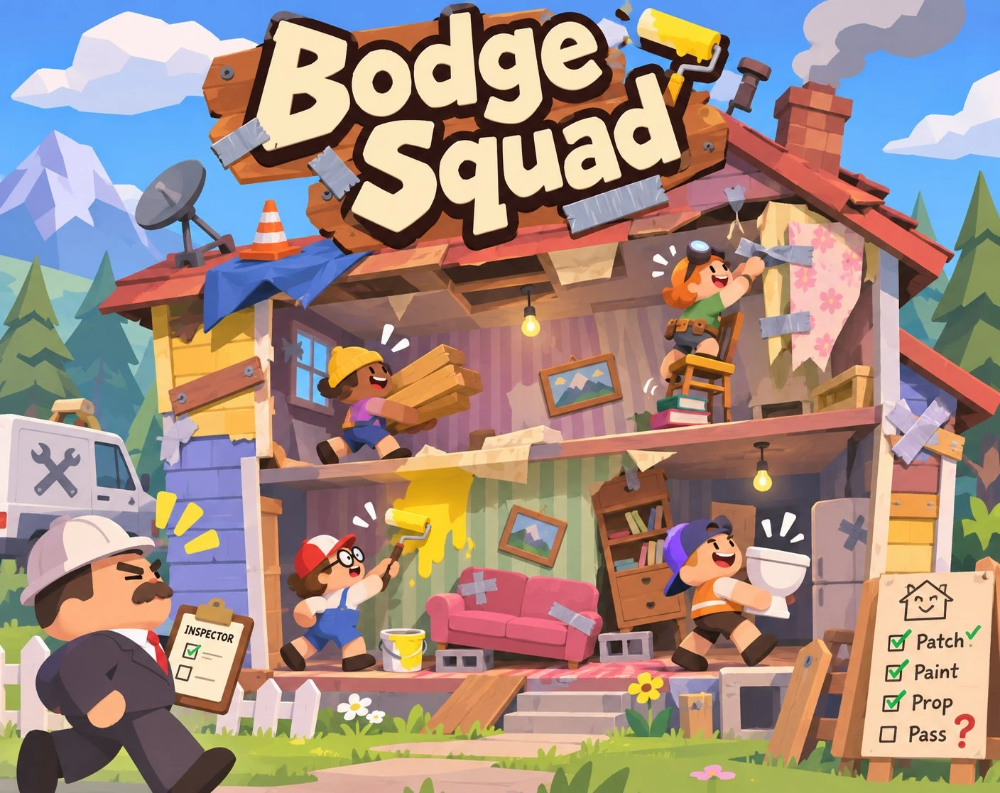
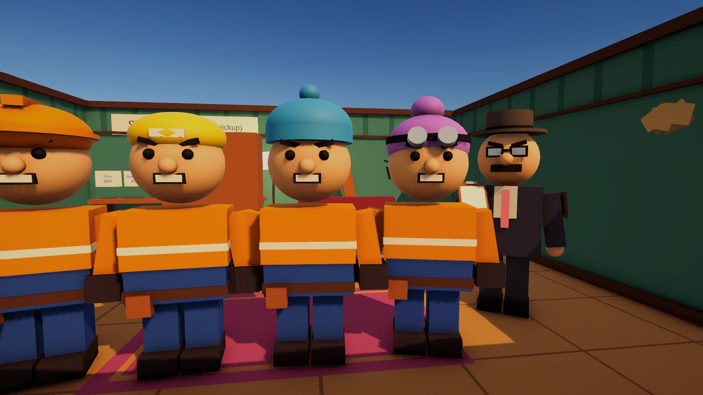
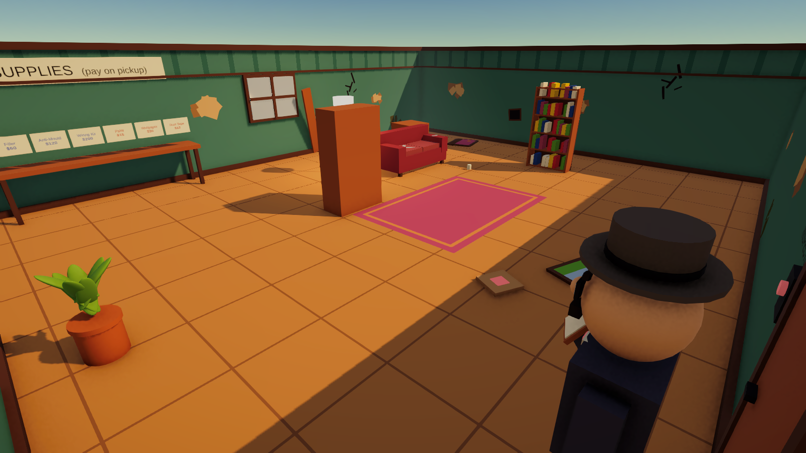
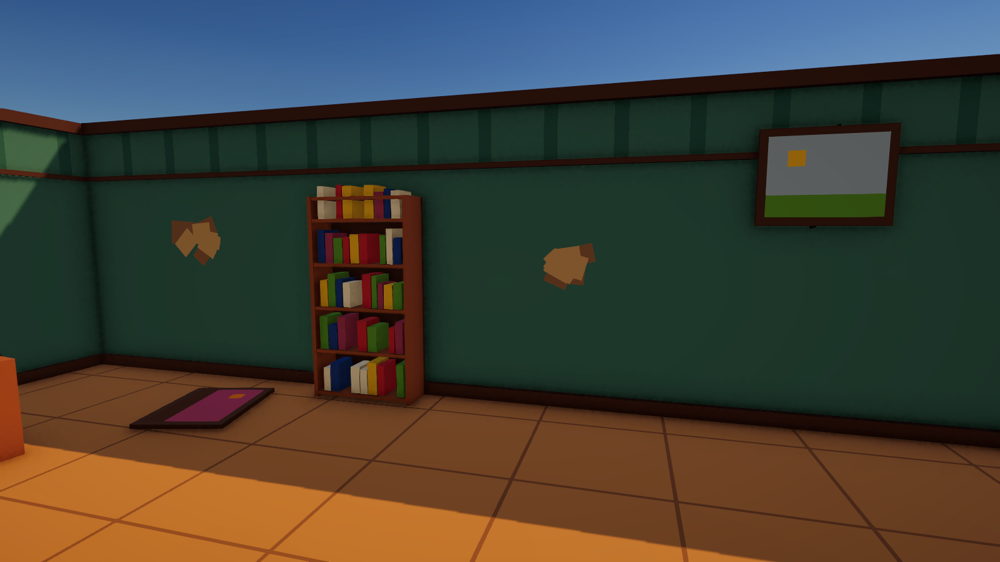
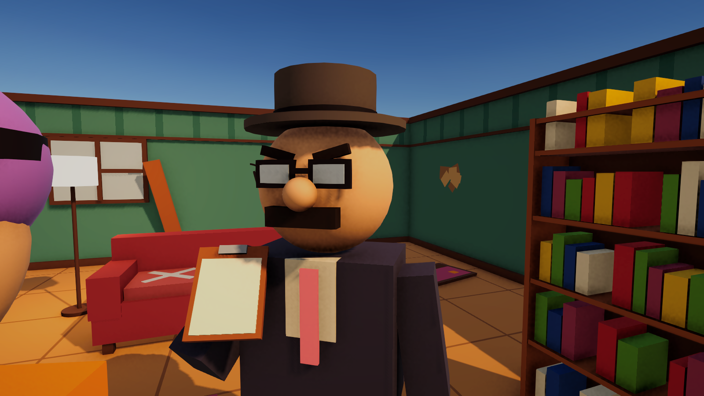
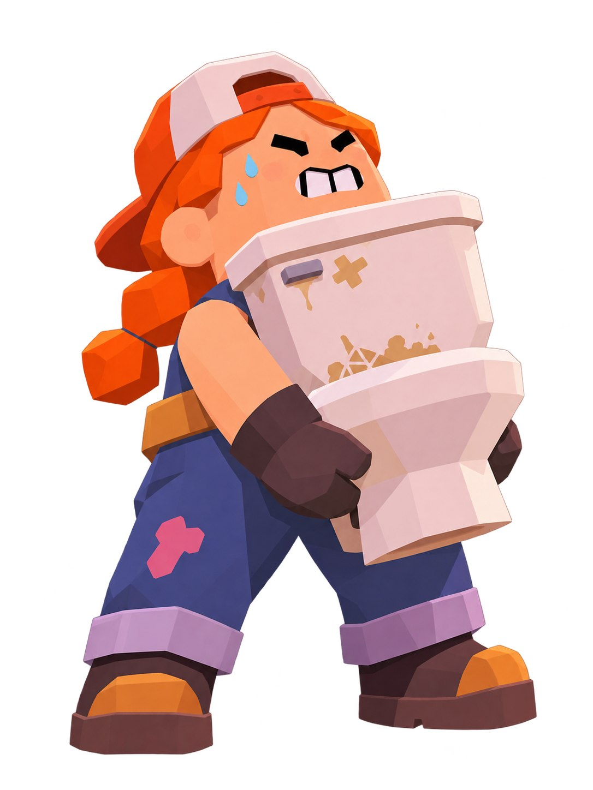
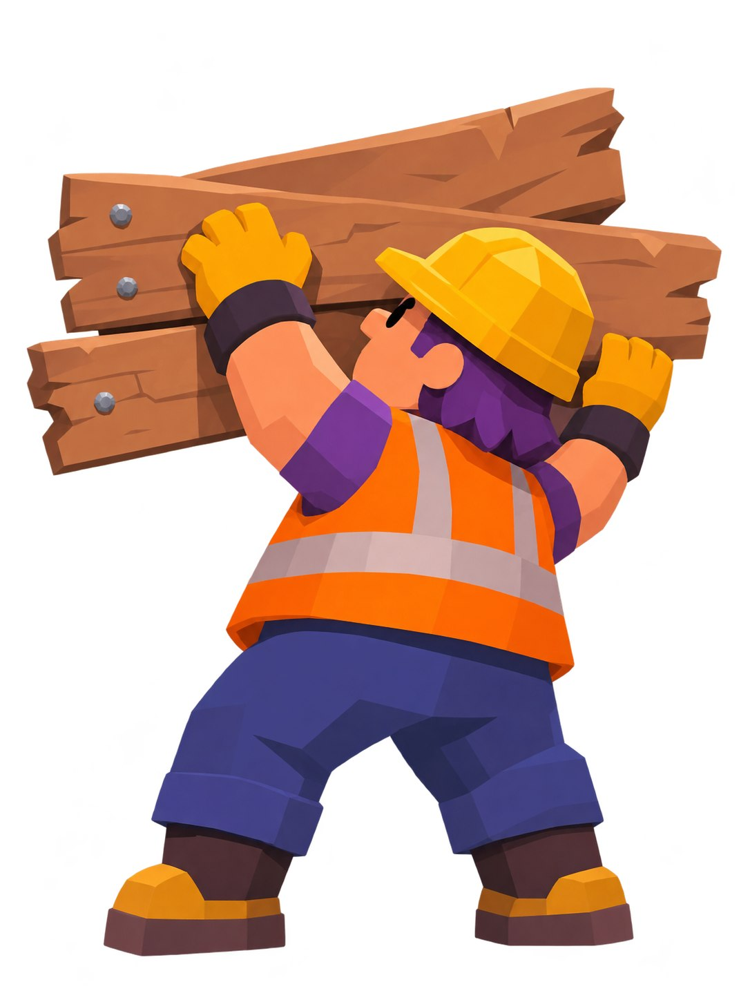
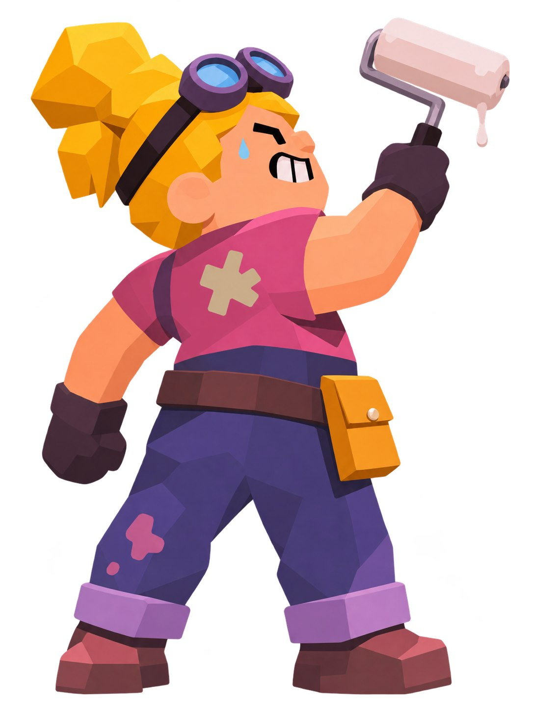
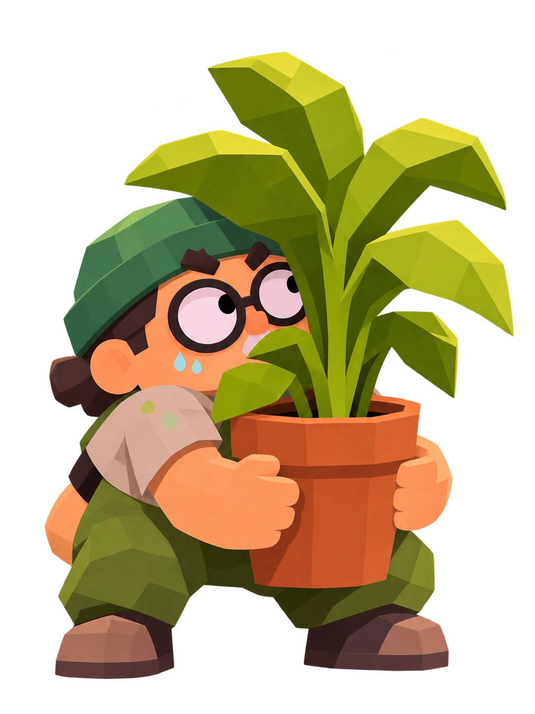

<div align="center">



# Bodge Squad

**Bodge it · Patch it · Hide it · Pass!?**

A local co-op comedy game about doing the bare minimum and getting away with it.

[](https://aybekk.itch.io/bodge-squad)


### 👉 [aybekk.itch.io/bodge-squad](https://aybekk.itch.io/bodge-squad)

</div>

---

## The pitch

You and up to three friends get a wrecked house and a fixed budget. Buy the cheapest materials you can find, patch what you can, and hide what you can't afford to fix. Then the inspector shows up, and you only get paid for what they don't notice.

One couch, one screen, up to four people who absolutely should not be trusted with power tools.

<p align="center">
  
  
</p>

## How a job plays

1. **Read the work order.** Every defect in the house is listed with its severity: cosmetic, *will fail later*, or **safety hazard**.
2. **Shop on a shared budget.** Grab supplies off the table and you've paid for them. Blue tags are proper fixes (safe, expensive). Red tags are bodges like paint, wallpaper and duct tape (cheap, risky).
3. **Fix it, hide it, or shove a wardrobe in front of it.** Furniture and pictures hide damage for free: pick one up, look at a defect, and it snaps into place.
4. **Ring the doorbell.** The inspector walks the house, taps the walls and peers behind the sofa. Each bodge they catch gets a red flag and costs you money.
5. **Get the report.** Every defect, who bodged it, the payout and your profit.

Fixing everything properly costs more than the budget, so the game is about deciding what to cut.

<p align="center">
  
  
</p>

## Design notes

- **One rule table.** The chance of getting caught depends only on *how* you hid something and *how bad* it was ([`RepairRules.cs`](Assets/Scripts/Job/RepairRules.cs)). The same shortcut on the same severity always carries the same risk, so players can learn it.
- **Real inspection categories.** Severity levels follow the structure of real home-inspection reports: cosmetic, future failure, safety.
- **A physical shop.** Picking an item up pays for it, so the budget is something you can see on the table, not a menu.
- **A live inspector.** Flags go up one at a time in front of everyone, so the payoff happens in the room, not on a results screen.
- **A risk meter by the crosshair.** It shows each player the chance of getting caught *before* they commit to a bodge.

## Tech

| | |
|---|---|
| Engine | Unity 6 (6000.6), URP |
| Players | 1–4 local, first-person split-screen via `PlayerInputManager` + Cinemachine 3 output channels |
| Input | Input System (keyboard & mouse, gamepads) |
| UI | uGUI + TextMeshPro, built from code |
| Physics | Velocity-driven carrying (held items still collide), throwable props, furniture that snaps in front of defects |
| Pipeline | Scenes, prefabs and materials built by editor scripts in [`Assets/Editor/ProjectBootstrap`](Assets/Editor/ProjectBootstrap); one palette file as the single source of colour ([`Palette.cs`](Assets/Scripts/Art/Palette.cs)) |

### Code map

```
Assets/Scripts
├── Job/          JobManager (budget, timer, phases), Defect, Inspector, RepairRules, PlayAreaGuard
├── Interaction/  CarryInteractor, Carryable, RepairKit, SupplyShelf, Concealer (furniture cover), Doorbell
├── Players/      FirstPersonController, PlayerSlot (split-screen wiring), BodgerMotion, SpawnOnJoin
├── UI/           PlayerHud (per-viewport prompts and risk meter), JobHud (work order, help, report)
└── Art/          Palette (art bible)
```

## Running it

1. Open the project in **Unity 6000.6** (Unity Hub → Add → this folder).
2. Open `Assets/Scenes/SampleScene` and press **Play**.
3. Press any key or gamepad button to join. Up to 4 players, one per device.

| Action | Keyboard | Gamepad |
|---|---|---|
| Move / look | WASD / mouse | Sticks |
| Buy, use, pick up, drop, hide behind | E | Y |
| Throw | Left mouse | X |
| Run / jump | Shift / Space | Stick press / A |
| How to play | Tab | Select |
| Next job (on the report) | R | Start |

## Characters

<p align="center">
  
  
  
  
</p>

Concept art. In game, the bodgers are blocky stand-ins that follow these designs until the 3D models are ready.

## Team

Made by **Mannapov Aibek**, **Kunbolov Alnur**, **Beisen Abylai** and **Daniyar Munsyzbayev**.

<div align="center">

**[▶ Bodge Squad on itch.io](https://aybekk.itch.io/bodge-squad)**

</div>
