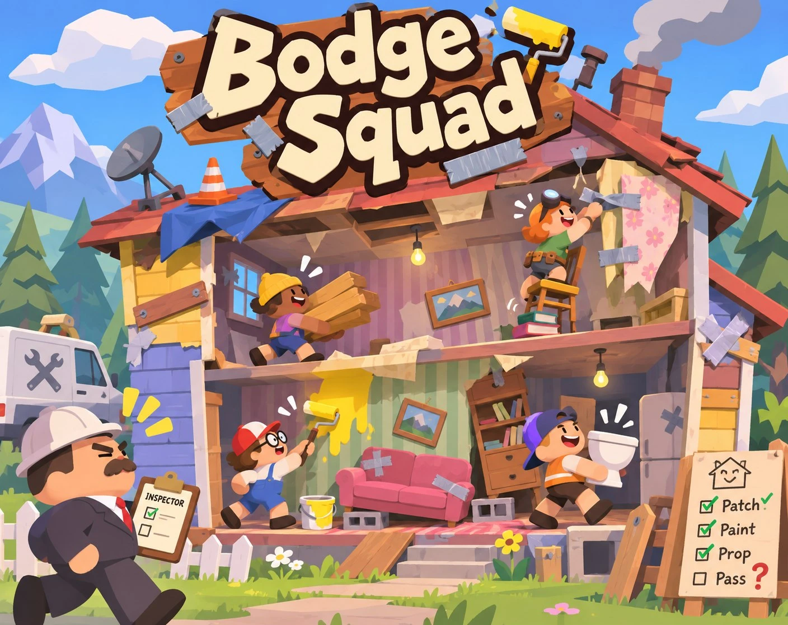
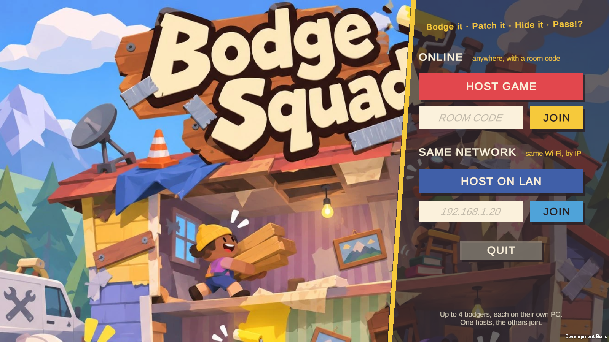
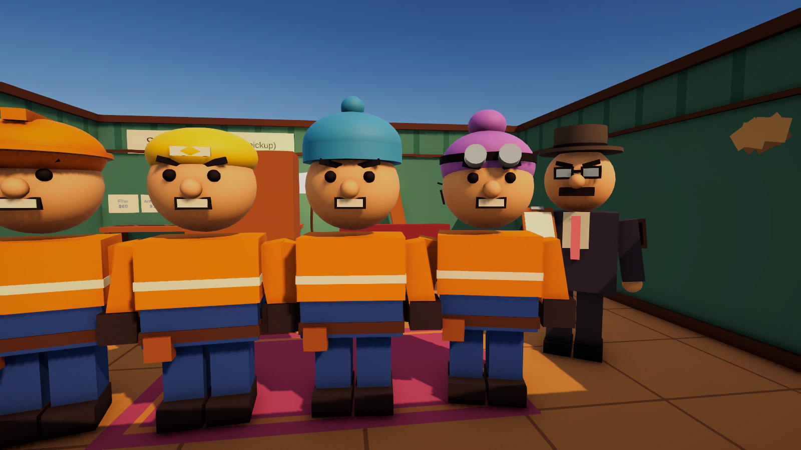
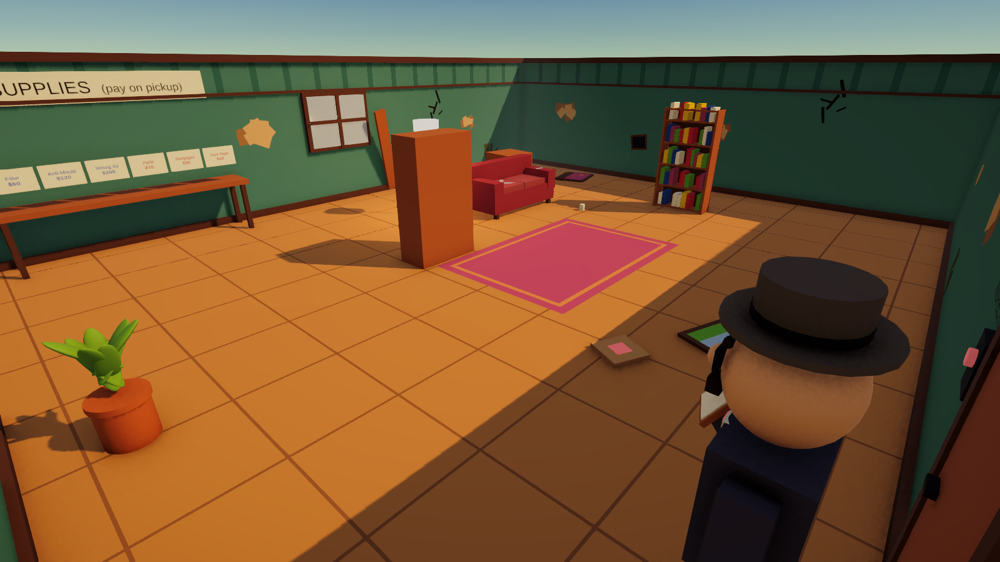
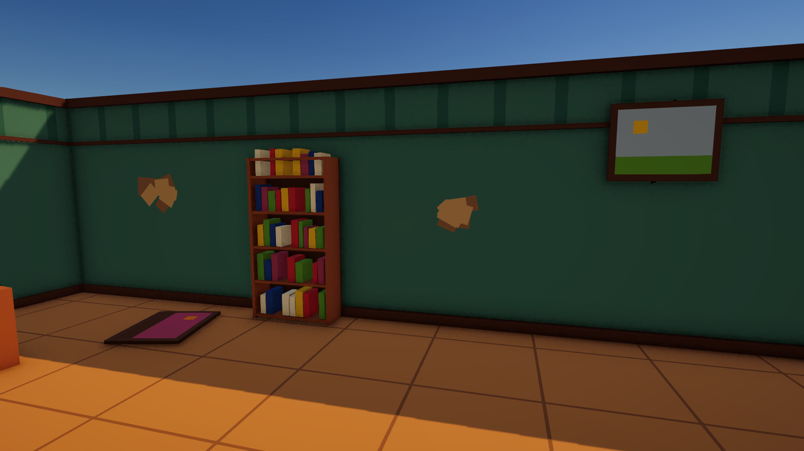
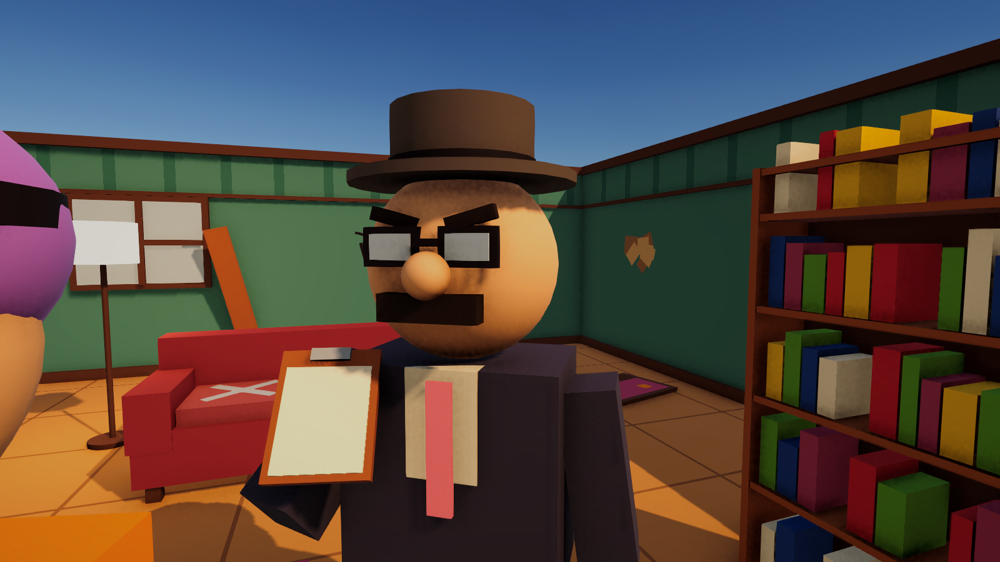
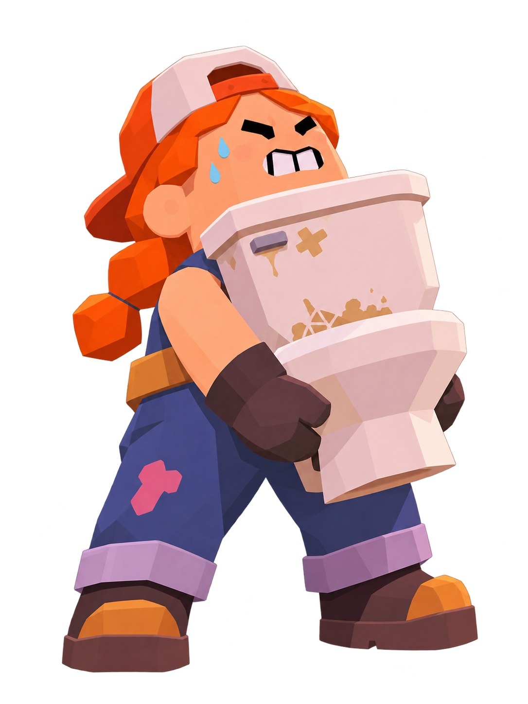
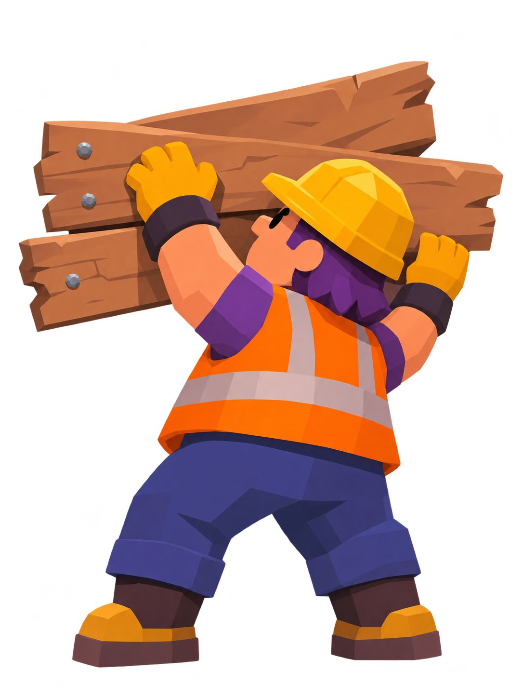
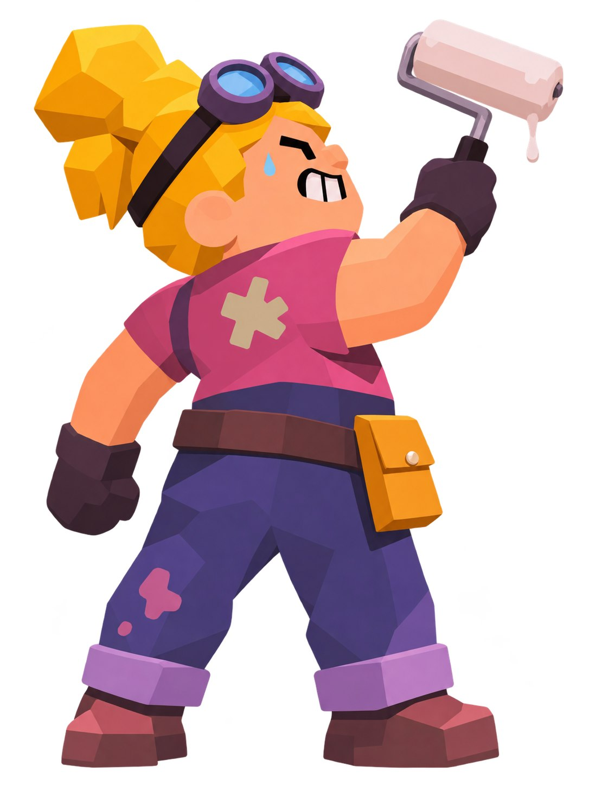

<div align="center">



# Bodge Squad

**Bodge it · Patch it · Hide it · Pass!?**

An online co-op comedy game about doing the bare minimum and getting away with it.

[](https://aybekk.itch.io/bodge-squad)


### 👉 [aybekk.itch.io/bodge-squad](https://aybekk.itch.io/bodge-squad)

</div>

---

## The pitch

You and up to three friends get a wrecked house and a fixed budget. Buy the cheapest materials you can find, patch what you can, and hide what you can't afford to fix. Then the inspector shows up, and you only get paid for what they don't notice.

Up to four people, each on their own PC, who absolutely should not be trusted with power tools. One hosts, the others join with a room code.

<p align="center"></p>

<p align="center">
  
  
</p>

## How a job plays

1. **Find the damage.** Cracks, holes, mould and bare wiring, each cosmetic, *will fail later*, or a **safety hazard**. Nobody hands you a checklist.
2. **Shop on a shared budget.** Grab supplies off the table and you've paid for them. Blue tags are proper fixes (safe, expensive). Red tags are bodges like paint, wallpaper and duct tape (cheap, risky).
3. **Do the work by hand.** Hold the mouse and sweep a tool over the damage: filler, anti-mould spray, paint, wallpaper; tape goes on one strip per click. Every patch is a grid, and any gap you miss stays visible. Tools run dry as you use them, misses included, so a sloppy painter has to buy another tin.
4. **Or cheat for free.** Shove a wardrobe or sofa flat against the damage, or carry a picture to the wall and hang it over the crack.
5. **Don't get caught in the act.** The inspector lets himself in early "for a quick look around". If he *sees* you painting, papering or taping (his view is drawn on the floor), his suspicion fills and you're caught red-handed: a fine, and that defect goes in his notebook. Throw something so it crashes, or switch on the radio in the corner, and bodge behind his back while he checks.
6. **Ring the doorbell.** The inspector walks the house, taps the walls and peers behind the sofa. Each bodge they catch gets a red flag and costs you money.
7. **Get the report.** Every defect, who bodged it, the payout and your profit.

Fixing everything properly costs more than the budget, so the game is about deciding what to cut.

<p align="center">
  
  
</p>

## Design notes

- **Coverage, not buttons.** A defect's risk is the average over its 8×8 cells: an uncovered cell counts 100%, a covered one counts at its material's risk. A proper fix counts once 90% is done.
- **One rule table.** The chance of getting caught depends only on *how* you hid something and *how bad* it was ([`RepairRules.cs`](Assets/Scripts/Job/RepairRules.cs)). The same shortcut on the same severity always carries the same risk, so players can learn it.
- **Real inspection categories.** Severity levels follow the structure of real home-inspection reports: cosmetic, future failure, safety.
- **A physical shop.** Picking an item up pays for it, so the budget is something you can see on the table, not a menu.
- **Slapstick physics.** Throw something at the inspector and he sees stars for 4 s; a paint tin in the face blinds him for 3 s (with an angry, synthesised grunt). Tins that smash on the floor leave slippery puddles: run through one and you go flat on your back, dropping whatever you held. A flying plank knocks your mates over too.
- **Stealth in a co-op job.** The inspector wanders the room while you work, so one player distracts him while the others slap paint on. Proper fixes are fine in front of him; only the cover-ups count.
- **A live inspector.** Flags go up one at a time in front of everyone, so the payoff happens in the room, not on a results screen.
- **A risk meter by the crosshair.** It shows each player the chance of getting caught *before* they commit to a bodge.

## Tech

| | |
|---|---|
| Engine | Unity 6 (6000.6), URP |
| Networking | Netcode for GameObjects 2.14, host-client. Join by room code over the internet (Unity Multiplayer Services) or by IP on a LAN |
| Authority | Host runs the job (budget, defects, inspector) via NetworkVariables and RPCs; each player drives their own bodger, and ownership of an item passes to whoever is carrying it |
| Input | Input System (keyboard & mouse, gamepads) |
| UI | uGUI + TextMeshPro, built from code |
| Physics | Velocity-driven carrying (held items still collide), throwable props, furniture that snaps in front of defects |
| Pipeline | Scenes, prefabs and materials built by editor scripts in [`Assets/Editor/ProjectBootstrap`](Assets/Editor/ProjectBootstrap); one palette file as the single source of colour ([`Palette.cs`](Assets/Scripts/Art/Palette.cs)) |

### Code map

```
Assets/Scripts
├── Job/          JobManager (budget, timer, phases), Defect, Inspector, RepairRules, PlayAreaGuard
├── Interaction/  CarryInteractor, Carryable, RepairKit, SupplyShelf, Concealer (furniture cover), Doorbell
├── Net/          NetSession (host / join by code / LAN), NetworkManagerGuard, NetSmokeTest
├── Players/      NetworkBodger (owner camera, hats by slot), BodgerInput, FirstPersonController, BodgerMotion
├── UI/           MainMenu (title, pause), PlayerHud (prompts, risk meter), JobHud (work order, help, report)
└── Art/          Palette (art bible)
```

## Running it

1. Open the project in **Unity 6000.6** (Unity Hub → Add → this folder).
2. Open `Assets/Scenes/SampleScene` and press **Play**.
3. **Host Game** gives a room code; friends press **Join** with it. On one network, **Host on LAN** + **Join by IP** work without an account.
4. To try 2–4 players on one machine: *Window → Multiplayer → Multiplayer Play Mode*, tick the extra players.

| Action | Keyboard | Gamepad |
|---|---|---|
| Move / look | WASD / mouse | Sticks |
| Buy, pick up, drop, hang a picture | E | Y |
| Work with a tool (hold and sweep) / throw | Left mouse | X |
| Run / jump | Shift / Space | Stick press / A |
| How to play | Tab | Select |
| Pause / room code / leave | Esc | Start |
| Next job (on the report) | R | Start |

## Characters

<p align="center">
  
  
  
  
</p>

Concept art. In game, the bodgers are blocky stand-ins that follow these designs until the 3D models are ready.

## Team

Made by **Mannapov Aibek**, **Kunbolov Alnur**, **Beisen Abylai** and **Daniyar Munsyzbayev**.

<div align="center">

**[▶ Bodge Squad on itch.io](https://aybekk.itch.io/bodge-squad)**

</div>
